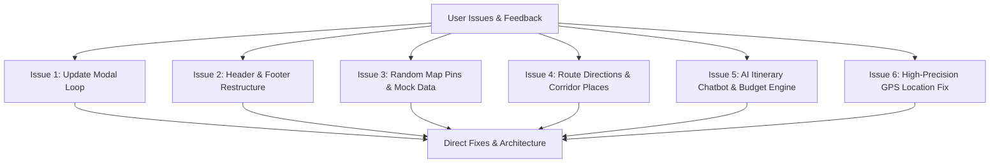

# TripWeave — Architecture & Comprehensive Implementation Plan

**Date:** October 27, 2026  
**Status:** Ready for Review & Approval  
**Application:** TripWeave v1.5.1 (Web & Android Hybrid Platform)

---

## 1. Executive Summary & Problem Diagnosis

This implementation plan directly resolves the six major structural, behavioral, and UI/UX issues identified during project analysis:



---

## 2. Detailed Issue Analysis & Remediation Strategy

### 📌 Issue 1: Infinite "Update Available" Modal Loop
- **Diagnosis:**
  - In [src/main.js](file:///d:/My-Projects/Tripline/src/main.js), `CURRENT_APP_VERSION = '1.5.0'` and `CURRENT_VERSION_CODE = 6` were hardcoded.
  - In [version.json](file:///d:/My-Projects/Tripline/version.json) and [app/build.gradle.kts](file:///d:/My-Projects/Tripline/app/build.gradle.kts), the version is already bumped to `1.5.1` with `versionCode = 7`.
  - Every time the application launches, `checkForAppUpdates()` fetches `version.json`, compares `7 > 6`, and immediately pops up the modal.
  - Clicking "Later" did not persist a dismissal record in `localStorage`.
  - On native Android, JavaScript had no bridge method to read the actual installed APK version from `PackageManager`.
- **Action Plan:**
  1. Add native methods in [MainActivity.kt](file:///d:/My-Projects/Tripline/app/src/main/kotlin/com/tripweave/app/MainActivity.kt):
     ```kotlin
     @JavascriptInterface
     fun getAppVersionCode(): Int {
         return try {
             if (Build.VERSION.SDK_INT >= Build.VERSION_CODES.P) {
                 packageManager.getPackageInfo(packageName, 0).longVersionCode.toInt()
             } else {
                 packageManager.getPackageInfo(packageName, 0).versionCode
             }
         } catch (e: Exception) { 7 }
     }
     ```
  2. In [src/main.js](file:///d:/My-Projects/Tripline/src/main.js), synchronize `CURRENT_APP_VERSION = '1.5.1'` and `CURRENT_VERSION_CODE = 7`. If running inside the Android container, fetch the true version from `window.AndroidAuthBridge.getAppVersionCode()`.
  3. When "Later" or the close button is clicked, store `tripweave_dismissed_update: { code: 7, timestamp: Date.now() }` in `localStorage` to permanently prevent loop re-triggers for the same version.

---

### 📌 Issue 2: Header and Footer Layout Restructuring
- **Diagnosis:**
  - On Android devices with punch-hole cutouts and status bars, the top search bar and filter chips crowd the top viewport.
  - The bottom peek sheet (`map-peek-sheet`) covers the bottom navigation bar (`app-nav`), creating an awkward overlap that prevents clean tab switching.
- **Action Plan:**
  1. **Top Header Bar:**
     - Enforce `--native-safe-top` dynamic inset clearance for the top search container.
     - Redesign the search bar into a clean pill with clear text action, quick route button, and account profile icon.
     - Move secondary chips into an orderly horizontal scroll row with balanced spacing.
  2. **Bottom Footer & Sheets:**
     - Restructure [src/style.css](file:///d:/My-Projects/Tripline/src/style.css) so `.app-nav` stays anchored at the bottom with standard safe-area padding (`env(safe-area-inset-bottom)`).
     - Reposition the bottom summary peek sheet to sit directly above the navigation bar (e.g., `bottom: calc(64px + env(safe-area-inset-bottom))`) with clean sliding behavior, ensuring it never masks the navigation tabs.

---

### 📌 Issue 3: Elimination of Random Pins and Mock Data
- **Diagnosis:**
  - [src/main.js](file:///d:/My-Projects/Tripline/src/main.js#L1371-L1414) runs `renderPlacesAroundSearchArea('all')` immediately upon map initialization, automatically dumping monuments and places from `FAMOUS_INDIAN_HUBS` all over India onto the map.
  - In [src/main.js](file:///d:/My-Projects/Tripline/src/main.js#L449-L510), corridor stops were generating synthetic names like *"Grand Highway Dhaba & Family Garden Restaurant"* using randomized math coordinates.
- **Action Plan:**
  1. **Clean Map State:** Remove automatic marker injection on startup. The map will load completely clean, displaying only the base map tiles and the user's live location dot.
  2. **Zero Mock Data Policy:**
     - Deprecate automatic dumping of dummy hubs.
     - Pins will appear on the map **only** when:
       a) The user actively searches for a location.
       b) The user generates a route from Origin to Destination.
       c) The user explicitly selects a category filter (Food, Stays, Fuel) for their active route.

---

### 📌 Issue 4: Route Directions & Real Corridor Amenities (Hotels & Restaurants)
- **Diagnosis:**
  - When setting from/to locations, the application was not displaying immediate driving route lines and turn-by-turn direction instructions on the map.
  - Genuine details for highway hotels, homestays, and authentic restaurants along that specific corridor were absent.
- **Action Plan:**
  1. **Quick Route Setup Interface:**
     - Provide a streamlined "Route Setup" component:
       - **Origin:** Defaults to "Current Location" (one-tap auto-fill) or manual search.
       - **Destination:** Searched and selected with instant geocoding.
  2. **Route Line & Directions:**
     - Fetch high-resolution OSRM driving geometry and render a vibrant blue driving polyline on Google Maps tiles.
     - Display total distance, driving duration, and turn-by-turn highway maneuvers in the top/bottom navigation HUD.
  3. **Real Corridor Amenities Discovery:**
     - Implement live corridor querying (via Overpass API / OSM Places engine with fallbacks) along the route polyline:
       - **Hotels & Stays:** Genuine hotels, lodges, and homestays along the highway.
       - **Dhabas & Food:** Authentic highway restaurants with genuine names, verified coordinates, and Google Maps direct links.
       - **Fuel & EV:** Official fuel stations (IOCL, BPCL, HPCL) and EV fast chargers.
     - Allow the user to tap any corridor card to view its photo, distance from the highway, and tap "+ Add to Itinerary".

---

### 📌 Issue 5: Interactive AI Chatbot in Itinerary & Transparent Budget
- **Diagnosis:**
  - The budget section relied on static calculations disconnected from the traveler's actual preferences.
  - The AI road trip planner was separated in a secondary modal instead of directly collaborating with the traveler inside the Itinerary.
- **Action Plan:**
  1. **Interactive AI Trip Assistant in the Itinerary Tab:**
     - Embed a conversational planning card directly in `#screen-itinerary` that interactively prompts:
       - *1. Journey:* Starting Point & Final Destination.
       - *2. Group Size:* Number of travelers.
       - *3. Total Budget:* Target expenditure (Total or Per-Person).
       - *4. Hotel Comfort Level:* Budget Homestay / 3-Star Comfort / Luxury Resort.
       - *5. Dining Style:* Authentic Highway Dhabas / Pure Veg / Multi-Cuisine Family Restaurants.
  2. **Groq Llama 3.3 Integration:**
     - Pass traveler preferences to Groq AI to calculate:
       - Research-backed fatigue breaks (every 2.5–3 hours).
       - Real recommended hotels matching the chosen comfort tier and budget.
       - Authentic highway meals and stop durations.
  3. **Automated Budget Synchronization:**
     - Automatically populate the **Budget** tab with the itemized breakdown:
       - Fuel cost: `(Total Route Distance / Vehicle Mileage) * Fuel Price`.
       - Hotel/Accommodations: Real nightly rates based on the chosen comfort tier × number of nights and rooms.
       - Highway meals: Meal count × travelers × average price per person.
       - NHAI Tolls: Segment FASTag estimates.
       - Reserve Contingency: 10% safety buffer.

---

### 📌 Issue 6: Pinpoint GPS Location Accuracy
- **Diagnosis:**
  - In [src/main.js](file:///d:/My-Projects/Tripline/src/main.js#L2218-L2219), pending or unacquired locations defaulted to hardcoded Bangalore coordinates (`12.9716, 77.5946`).
  - In [MainActivity.kt](file:///d:/My-Projects/Tripline/app/src/main/kotlin/com/tripweave/app/MainActivity.kt#L388), `getBestLocationJson()` permitted stale cached locations up to 5 minutes old.
- **Action Plan:**
  1. Eliminate all fallback defaults to Bangalore coordinates.
  2. In [MainActivity.kt](file:///d:/My-Projects/Tripline/app/src/main/kotlin/com/tripweave/app/MainActivity.kt), configure `LocationManager.requestLocationUpdates` with `GPS_PROVIDER` (and `FusedLocationProviderClient`) requesting zero minimum time and distance for an immediate, high-priority fix on launch.
  3. In [src/main.js](file:///d:/My-Projects/Tripline/src/main.js), show a clean "Acquiring high-accuracy GPS..." status pill, and center the map only when verified coordinates from the device hardware are received.
  4. Render the authentic Google Maps pulsing blue dot with directional cone and calibrated GPS accuracy ring.

---

## 3. Implementation Phasing & File Changes

| Phase | Files to Modify | Key Changes |
| :--- | :--- | :--- |
| **Phase 1: Update Loop & Versioning** | [app/.../MainActivity.kt](file:///d:/My-Projects/Tripline/app/src/main/kotlin/com/tripweave/app/MainActivity.kt)<br>[src/main.js](file:///d:/My-Projects/Tripline/src/main.js)<br>[version.json](file:///d:/My-Projects/Tripline/version.json) | Add `getAppVersionCode()` bridge, sync JS version to 1.5.1/7, add localStorage dismissal cache. |
| **Phase 2: GPS Precision & Zero Mock Data** | [src/main.js](file:///d:/My-Projects/Tripline/src/main.js)<br>[app/.../MainActivity.kt](file:///d:/My-Projects/Tripline/app/src/main/kotlin/com/tripweave/app/MainActivity.kt) | Purge `renderPlacesAroundSearchArea('all')` on startup; remove hardcoded Bangalore defaults; force immediate high-accuracy GPS. |
| **Phase 3: Header & Footer Restructure** | [index.html](file:///d:/My-Projects/Tripline/index.html)<br>[src/style.css](file:///d:/My-Projects/Tripline/src/style.css) | Apply notch clearance to header; fix bottom nav anchoring and peek sheet layering so tabs are never covered. |
| **Phase 4: Route Directions & Real Corridor Amenities** | [src/main.js](file:///d:/My-Projects/Tripline/src/main.js)<br>[index.html](file:///d:/My-Projects/Tripline/index.html) | Provide fast From/To setup; render OSRM route path & turn maneuvers; query real hotels, dhabas, and fuel along the route corridor. |
| **Phase 5: Itinerary AI Assistant & Budget Sync** | [src/main.js](file:///d:/My-Projects/Tripline/src/main.js)<br>[index.html](file:///d:/My-Projects/Tripline/index.html)<br>[src/engines.js](file:///d:/My-Projects/Tripline/src/engines.js) | Embed conversational planning prompt in Itinerary tab; link answers to Groq AI; compute exact hotel/meal/fuel budget cards. |
| **Phase 6: Build Verification & Testing** | [build-apk.bat](file:///d:/My-Projects/Tripline/build-apk.bat) | Build Vite production bundle; sync assets to Android; compile signed release APK and verify zero update loops. |

---

## 4. Verification & Testing Criteria

1. **Update Loop:** On opening the app or refreshing, the "Update Available" modal must **not** appear if already on version 1.5.1. Clicking "Later" must keep it dismissed.
2. **Clean Map:** On loading the map, zero random monument pins must be present. Only the user's location dot appears.
3. **Location Accuracy:** The map must center on the user's actual physical coordinates, not Bangalore or any other default location.
4. **Route & Directions:** Setting Origin and Destination draws the route polyline and displays distance, duration, and turn-by-turn guidance.
5. **Corridor Stops:** Real hotels and restaurants along the route corridor are shown with authentic names and locations.
6. **AI Itinerary Chatbot & Budget:** The Itinerary assistant collects group size, budget, and hotel comfort preferences, generating an itemized plan that syncs into the Budget tab.
7. **Header & Footer:** Nav tabs remain fully visible, accessible, and unobstructed by the bottom sheet.
