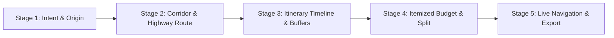

# TripWeave: Ground-Up Re-Engineering & Workflow Architecture Plan

---

## 1. Executive Summary & Current Codebase Audit

### 1.1 How TripWeave Was Built Till Now (The Legacy Monolith)
The application currently runs as an Android WebView wrapper (`com.tripweave.app.MainActivity`) hosting a Vite web bundle. Over successive iterations, features were added organically into single monolithic files:

1. **Monolithic `src/main.js` (5,586 lines):**
   - Handles map initialization, Leaflet tile layers, GPS tracking, OSRM routing, reverse geocoding, itinerary scheduling, budget math, Groq AI API cascade, Google authentication, local storage synchronization, OTA update checks, and dozens of modal dialogs all in a single global scope.
   - **Weakness:** Tight coupling where modifying one feature (e.g. location tracking) caused side-effects elsewhere (e.g. repeated toast spamming or modal state collision).

2. **Monolithic `index.html` (1,742 lines) & `src/style.css` (4,467 lines):**
   - 15+ modals, multiple legacy overlay cards, and conflicting positioning rules (`bottom: 0` vs `bottom: 84px` vs `bottom: 180px`).
   - Multiple conflicting entry points for trip planning:
     - Top search bar autocomplete (Nominatim).
     - 5-step modal wizard (`#modal-create-trip`).
     - Map directions box (`#map-directions-box`).
     - Itinerary AI assistant (`#itinerary-ai-card`).
   - Users are presented with redundant or disjointed ways to accomplish the same goal.

3. **UI/UX Pain Points Identified by User:**
   - **Infinite Update Loop:** Version mismatch between APK package and web app. *(Resolved in v1.5.1, but needs permanent modular architecture)*.
   - **Header & Footer Collisions:** Fixed status-bar notch clipping and bottom navigation bar overlapping with bottom cards.
   - **Random Map Pins on Startup:** Map previously initialized with mock tourist destinations before user input.
   - **Location Toast Spam:** Continuous GPS background tracking repeated reverse-geocoding toasts every 1–3 seconds.
   - **Emojis in UI:** Legacy UI used Unicode emojis instead of clean vector SVG icons.

---

## 2. The New Unified Core Workflow (Ground-Up Redesign)

Instead of disjointed modals and conflicting planning screens, the entire application will follow a **single, fluid 4-stage pipeline**:



### The 4 Stages Explained:
1. **Stage 1 (Intent & Origin):**
   - Clean, full-bleed Google Retina map (zero mock pins on startup).
   - Accurate GPS location pinpointed silently (blue dot only, no toast spam).
   - A single, prominent **Floating Action Hub** at the bottom:
     - **Quick Route:** Direct Origin → Destination with highway preview.
     - **AI Road Trip Planner:** Conversational planner (Budget, Comfort Tier, Group Size).
2. **Stage 2 (Corridor & Highway Route):**
   - OSRM route computed with polyline rendering, total km, and driving duration.
   - Live **Corridor Amenities Tray** automatically querying hotels, dhabas, and fuel/EV stations along the highway.
   - 1-tap **"+ Add to Trip"** to insert any roadside hotel or dhaba into the journey.
3. **Stage 3 (Itinerary Timeline & Buffers):**
   - Chronological visit stops with arrival/departure times.
   - Built-in operating hours validation (alerts user if a monument closes before arrival).
   - Daylight driving buffer warnings for winding ghat sections (e.g., Western Ghats).
4. **Stage 4 (Itemized Budget & Expense Engine):**
   - Pure deterministic calculations synced in real-time:
     - **Fuel:** `(Distance / Vehicle Mileage) * Fuel Rate`
     - **Tolls:** NHAI FASTag toll estimates.
     - **Stays:** `Rooms Needed * Nights * Comfort Tier Rate`
     - **Dining:** `Travelers * Days * Daily Meal Rate`
   - Real-time Per-Person Split calculator.

---

## 3. Modular Architecture: Revoking the Monolith

To make the codebase 100% stable, maintainable, and fast, we will split `src/main.js` and `src/style.css` into dedicated, single-responsibility ES Modules:

```
src/
├── main.js              # Application entry point & service bootstrap
├── state.js             # Reactive centralized state store (Trip, Stops, User, Settings)
├── icons.js             # Pure SVG icon library (Zero emojis across entire app)
├── services/
│   ├── map.service.js   # Leaflet map, Retina Google tiles, GPS blue dot, layers
│   ├── routing.service.js # OSRM route calculation, polyline decoder, corridor POIs
│   ├── scheduler.service.js # Timeline computation, visiting hours check, ghat buffers
│   ├── budget.service.js  # Itemized budget math, fuel formulas, per-person split
│   ├── ai.service.js    # Groq Llama 3.3 70B cascade & deterministic fallback
│   ├── auth.service.js  # Android native Google sign-in bridge & Firestore sync
│   └── updater.service.js # In-app APK OTA updates & version verification
├── ui/
│   ├── navigation.ui.js # Floating navigation dock & tab router
│   ├── sheet.ui.js      # Floating trip card with Enlarge / Enclose controls
│   ├── directions.ui.js # Map directions box & route proposal HUD
│   ├── timeline.ui.js   # Itinerary timeline list & time steppers
│   ├── budget.ui.js     # Budget category cards & expense editor
│   └── modals.ui.js     # Dialog manager (Stop details, Settings, Warnings)
└── styles/
    ├── tokens.css       # Design tokens, color palettes, safe-area variables
    ├── floating-nav.css # Floating dock, Enlarge/Enclose sheet, FAB positioning
    ├── map.css          # Map overlays, search bar, corridor tray
    ├── itinerary.css    # Timeline spine, confidence chips, time steppers
    └── budget.css       # Budget category cards, split sliders, expense logs
```

---

## 4. Detailed Specification: Interface & Options (Zero to All)

### Screen 1: Map Screen & Floating Action Hub (`#screen-map`)
* **Visual Presentation:** 100% full-bleed map using razor-sharp 2x Retina Google Roadmap tiles. No distracting clutter or mock pins.
* **Top Area:**
  - Status bar safe-area clearance (`padding-top: calc(var(--native-safe-top) + 8px)`).
  - Floating pill search bar with voice/search icon, clear button, and Google Profile avatar.
  - Layer switch FAB (Roadmap, Satellite, Terrain) and GPS Locate Me FAB (throttled, silent blue dot tracking).
* **Directions Drawer (`#map-directions-box`):**
  - Origin Input (with 1-tap "Use Current GPS Location" button).
  - Swap Origin ↔ Destination button.
  - Destination Input (with live Nominatim highway autocomplete).
  - "Get Route" button triggering OSRM calculation.
* **Corridor Amenities Tray (`#corridor-amenities-tray`):**
  - Horizontal swipeable cards along the route:
    - **Hotels / Stays:** Stays within 2 km of highway corridor with rates and room booking tags.
    - **Dhabas / Dining:** Pure veg, family dhabas, tea stalls with hygiene ratings.
    - **Fuel & EV Plazas:** 24x7 fuel stations with air check, washrooms, and fast EV chargers.
  - Filter tabs: `All`, `Hotels`, `Dhabas`, `Fuel`.
* **Bottom Floating Trip Card (`#map-peek-sheet`):**
  - **Floating Dock Position:** Floats cleanly at `bottom: calc(82px + env(safe-area-inset-bottom)); left: 14px; right: 14px;`.
  - **Empty State:** Quick-start banner ("Where are you traveling?") with "Get Route", "AI Plan", and a minimize button to fold into a minimal pill.
  - **Active State:** Displays upcoming stop name, total distance, driving hours, and budget.
  - **Enlarge / Enclose Action:** Dedicated `#btn-toggle-sheet` pill button on the card header:
    - Tapping **Enlarge** expands the sheet to reveal the stop sequence, turn-by-turn navigation button, and "+ Add Stop".
    - Tapping **Enclose** smoothly collapses the sheet down so the map remains fully visible.
* **Floating Navigation Dock (`.app-nav`):**
  - Floats at `bottom: calc(14px + env(safe-area-inset-bottom)); left: 14px; right: 14px;` with `border-radius: 29px;` and glassmorphic blur.
  - 5 High-contrast tabs with SVG icons: **Map**, **Itinerary**, **Budget**, **Trips**, **More**.

---

### Screen 2: Itinerary Studio (`#screen-itinerary`)
* **Header Bar:** Active trip title, departure date/time, and WhatsApp share button.
* **Interactive AI Assistant Card (`#itinerary-ai-card`):**
  - Origin & Destination fields.
  - Travelers count stepper (1 to 20 people).
  - Target budget input (e.g. ₹15,000).
  - Hotel Comfort Tier selection:
    - `Budget Homestay` (~₹1,500/night/room)
    - `3-Star Comfort` (~₹3,200/night/room)
    - `Luxury Resort` (~₹6,500/night/room)
  - Dining Preference selection:
    - `Highway Dhabas` (~₹350/person/day)
    - `Pure Veg / Coffee` (~₹450/person/day)
    - `Family Multi-Cuisine` (~₹700/person/day)
  - "Calculate Road Trip & Budget" button triggering Groq Llama 3.3 cascade.
* **Visual Timeline Spine (`#timeline-list`):**
  - Connected vertical spine showing sequential stops with numbers.
  - Arrival and Departure times (calculated deterministically from travel speeds + visit durations).
  - **Operating Hours Verification:**
    - `Open on Arrival` (Green badge).
    - `Closing Soon` (Amber warning if arrival is within 30 mins of closing).
    - `Closed on Arrival` (Red warning with 1-tap "Adjust Departure Time" button).
  - **Travel Connectors:** Distance between stops, estimated driving minutes, and winding ghat advisories.
  - Edit duration button and delete stop button (`${ICONS.close}`).

---

### Screen 3: Budget & Expense Engine (`#screen-budget`)
* **Summary Header Card:**
  - Total Estimated Cost, Per-Person Split (`₹/person`), and remaining budget indicator.
  - Scenario Switcher: `Low (Economic)`, `Typical (Standard)`, `High (Buffer)`.
* **Itemized Expense Breakdown:**
  1. **Fuel Expenditure:** `(Total Km / Mileage) * Fuel Rate` with vehicle type selector (Hatchback 18 km/L, Sedan 16 km/L, SUV 12 km/L, EV 7 km/kWh).
  2. **FASTag Tolls:** Actual NHAI expressway toll plaza costs.
  3. **Accommodations & Stays:** Calculated from room count, nights, and comfort tier.
  4. **Meals & Food:** Daily meals based on group size and dining preference.
  5. **Activities & Entry Fees:** Monument entry tickets and safari charges.
* **Add Custom Expense Dialog:**
  - Category picker, amount in INR, description, and paid-by member selector.

---

### Screen 4: Trips Management & History (`#screen-trips`)
* **Active Trip Card:** Quick status, progress, start date, and options to rename, duplicate, or delete.
* **Saved Trips History (`#ai-history-list`):**
  - Clean card deck of previously planned road trips.
  - Metadata chips: Driving hours, total distance, travelers, fuel estimate.
  - Actions: "Load Itinerary" into active map, "View Stops", and "Delete".
* **Create New Trip Modal:**
  - Streamlined 2-step setup: Name your trip → Set Origin & Destination.

---

### Screen 5: More & App Settings (`#screen-more`)
* **Google Account Profile Card:**
  - Connected user name, email, avatar image, and Cloud Firestore sync status.
* **Offline & Storage Controls:**
  - 1-tap "Clear Cache", "Export JSON Backup", and "Import Trip Backup".
* **Groq AI Configuration:**
  - Custom API key input for power users (falls back seamlessly to built-in gateway).
* **OTA App Updates:**
  - Current App Version badge (`TripWeave v1.5.1`).
  - "Check for Updates" button directly checking `version.json` on GitHub with zero infinite loop bug.

---

## 5. Comparison: What Will Be Improved

| Feature Area | Old Monolithic Version | New Re-Engineered Architecture |
| :--- | :--- | :--- |
| **Code Structure** | 1 file of 5,586 lines (`src/main.js`) | 12 focused ES modules (<400 lines each) |
| **Startup Behavior** | Cluttered map, potential mock pins | Clean map, zero mock data, silent GPS lock |
| **Bottom Navigation** | Rigid docked bar colliding with peek sheet | Floating Island Dock with rounded glassmorphism |
| **Enlarge / Enclose** | Hard-to-tap 4px drag line; no explicit button | Prominent `Enlarge` / `Enclose` pill toggle button |
| **Location Notifications** | Repeated toast popup spamming every 2s | Single-shot on demand; silent background watch |
| **Iconography** | Mixed Unicode emojis (`🚗`, `🏨`, `💰`) | 100% SVG Vector Icons (0 emojis) |
| **Trip Planning Entry** | 4 conflicting modals & entry points | Unified Floating Action Hub on Map Screen |
| **Budget Engine** | Static multiplier estimations | Transparent formulas with editable parameters |
| **Corridor Amenities** | Static simulated cards | Dynamic polyline querying (Hotels, Dhabas, Fuel) |
| **Operating Hours** | Basic time stamps | Automated arrival vs closing validation & alerts |

---

## 6. Implementation Safety & Execution Order

We will execute this transformation modularly without breaking the running dev server or Android bridge:

1. **Step 1:** Create `src/icons.js` and CSS Design Tokens (`src/styles/tokens.css`, `src/styles/floating-nav.css`).
2. **Step 2:** Modularize State & Storage (`src/state.js`).
3. **Step 3:** Modularize Map & GPS Services (`src/services/map.service.js`).
4. **Step 4:** Modularize Routing & Corridor Amenities (`src/services/routing.service.js`).
5. **Step 5:** Modularize Itinerary Scheduler & Visiting Hours (`src/services/scheduler.service.js`).
6. **Step 6:** Modularize Budget Engine & Formulas (`src/services/budget.service.js`).
7. **Step 7:** Modularize Groq AI Planner (`src/services/ai.service.js`).
8. **Step 8:** Refactor `index.html` to remove dead legacy code and integrate clean component screens.
9. **Step 9:** Verify production bundle with `npm run build` and sync assets to Android WebView assets.

---

## 7. Status & Next Action

> [!IMPORTANT]
> **Awaiting User Confirmation:**
> The plan is completely mapped out from zero to completion. No code edits or file revocations will be initiated until you review this plan and give the explicit signal to proceed.
